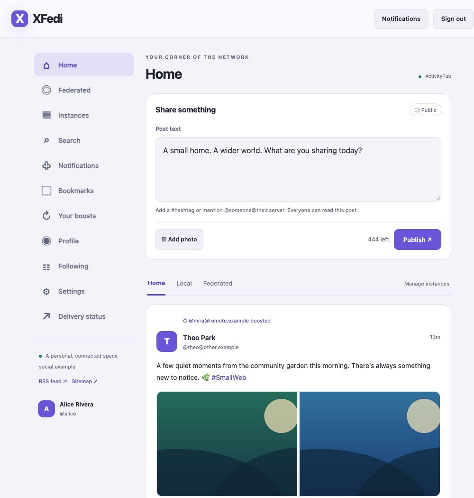
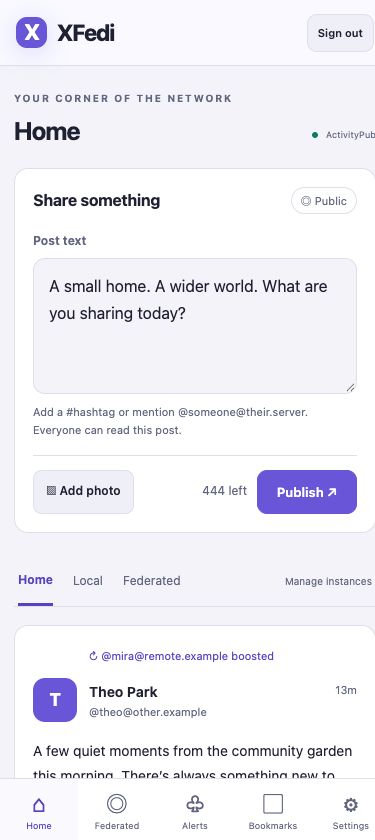
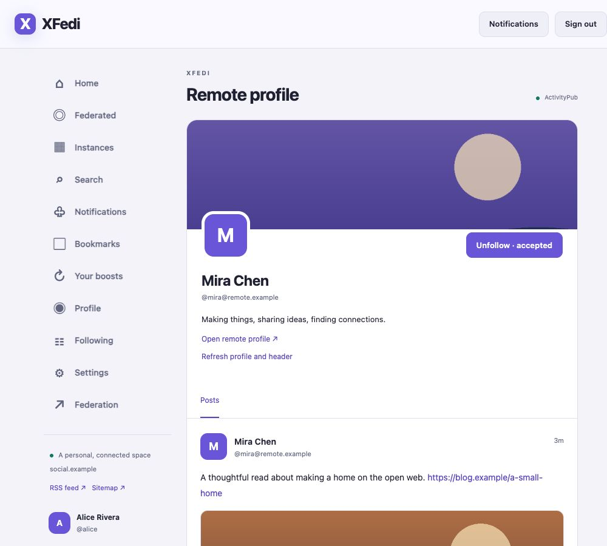
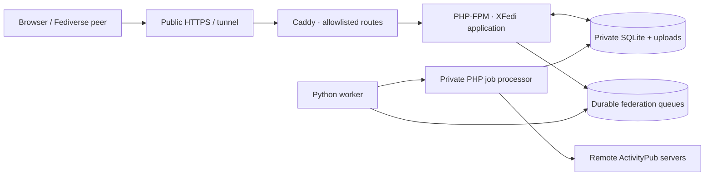

# XFedi

### Your self-hosted home on the Fediverse

**A lightweight, single-account ActivityPub social platform powered by PHP, Python, SQLite, and Docker.**

[](https://github.com/xsukax/XFedi/releases)
[](https://github.com/xsukax/XFedi/blob/main/LICENSE)
[](https://github.com/xsukax/XFedi/actions/workflows/ci.yml)
[](https://www.w3.org/TR/activitypub/)

**[Live Demo](https://xfedi.xsukax.net/)** · **[Documentation](#documentation)** · **[Install](#installation)** · **[Report an Issue](https://github.com/xsukax/XFedi/issues)**



## Table of Contents

- [Overview](#overview)
- [Features](#features)
- [Demo and Screenshots](#demo-and-screenshots)
- [Prerequisites](#prerequisites)
- [Installation](#installation)
- [Configuration](#configuration)
- [Usage](#usage)
- [Upgrading an Existing Installation](#upgrading-an-existing-installation)
- [Architecture and Project Structure](#architecture-and-project-structure)
- [Testing and Validation](#testing-and-validation)
- [Security](#security)
- [Contributing](#contributing)
- [Roadmap and Current Limitations](#roadmap-and-current-limitations)
- [Documentation](#documentation)
- [License](#license)
- [Author and Maintainers](#author-and-maintainers)
- [Contact and Support](#contact-and-support)

## Overview

**XFedi** is an open-source, self-hosted social networking application for people who want to maintain their own presence on the decentralized **Fediverse**. A single XFedi installation hosts **one local account** and can communicate with compatible ActivityPub servers, including Mastodon instances, without depending on a central social network.

Version **2.1.0** provides a modular PHP application, a Python background worker, SQLite persistence, and a Docker Compose deployment with Caddy. It combines a responsive social interface with account discovery, signed federation, public timelines, notifications, RSS feeds, website association checks, and administrative backup/restore tools.

XFedi is designed for **personal instances, developers, small self-hosting environments, and Fediverse enthusiasts**. It prioritizes ownership, a small deployment footprint, understandable code, and careful handling of remote content.

> **Scope:** XFedi is a **single-user, public-post ActivityPub server**, not a full Mastodon replacement. It implements server-to-server ActivityPub but **does not provide Mastodon's REST/client API or universal compatibility with every Fediverse implementation**. See [Current Limitations](#roadmap-and-current-limitations) and [FEDERATION.md](FEDERATION.md).

## Features

### Social experience

- **Responsive interface:** Desktop, tablet, and mobile layouts, light/dark styling, accessible forms, and mobile sign-in.
- **Posts and conversations:** Publish public text and image posts, reply, mention accounts, browse hashtags, edit posts, and delete your own content.
- **Engagement:** Favourite/unfavourite, boost/unboost, and create linked quote posts with readable fallback links.
- **Bookmarks:** Save posts privately without broadcasting bookmark activity to remote servers.
- **Three timeline views:** Home (followed accounts), Local (locally authored content), and Federated (known public remote posts and selected public instance sources).
- **Remote content presentation:** Profile headers, image galleries, GIF/WebP/AVIF imagery, video/audio playback controls, and compatible incoming quote/boost previews.
- **Link previews:** Cards derived from supported Open Graph, Twitter, JSON-LD, oEmbed thumbnail, and WordPress metadata; untrusted embedded scripts are not executed.
- **Notifications:** Follow, reply, mention, favourite, boost, quote, and follow-response events; unread counts and read/unread management.
- **Timezones:** Per-account IANA timezone preference for display; network timestamps remain in UTC.

### Federation and discovery

- **ActivityPub server-to-server communication** with actor, inbox/outbox, follow collection, and public Note support.
- **WebFinger and NodeInfo** endpoints for remote account and server discovery.
- **Signed requests:** RSA-SHA256 HTTP signatures and signed GET requests for compatible secure-mode peers.
- **Activity handling:** Follow/Accept/Reject, Create/Update/Delete, Like/Undo, and Announce/Undo where supported.
- **Delivery reliability:** Durable inbound/outbound queues, retries with backoff, deduplication, and replay protection.
- **Remote search and instance sources:** Resolve remote account/post identifiers and optionally import bounded public timeline samples from compatible instances.
- **Human-readable URLs:** Profiles such as `/@alice` and posts such as `/@alice/123`, while preserving canonical federation identifiers.

### Publishing, discovery, and operations

- **RSS:** `/feed.rss`, `/@username.rss`, and `/tags/hashtag.rss` for eligible local public content.
- **Search-engine discovery:** Paginated XML sitemaps, robots endpoint, and social sharing metadata.
- **Website association:** Automated HTTPS checks that distinguish site reachability, profile backlinks/same-domain association, and stricter `rel="me"` verification.
- **Backups and recovery:** Database-plus-media backups, validation before restore, and identity-preserving migrations.
- **Container isolation:** PHP-FPM and Python worker containers, Caddy route allowlisting, private persistent data volume, and loopback-only host binding by default.
- **Developer tooling:** Automated tests, release validation documentation, operational health checks, and GitHub Actions CI.

## Demo and Screenshots

**Live demonstration:** **https://xfedi.xsukax.net/**

Browse the public interface to explore the timeline, profiles, and navigation. Posting and account administration require authentication; the public demo is not an invitation to create accounts on the owner's instance.

| Desktop | Mobile |
| --- | --- |
|  |  |



**Direct screenshot links:** [Desktop preview](https://github.com/xsukax/XFedi/blob/main/docs/preview-desktop.jpg) · [Mobile preview](docs/preview-mobile.jpg) · [Remote profile preview](docs/preview-remote-profile.jpg)

> Screenshots are stored under [`docs/`](docs/) and will render on GitHub once those image files are committed to the repository.

## Prerequisites

### Recommended production deployment

| Component | Requirement |
| --- | --- |
| Operating system | A host that supports Docker Engine or Docker Desktop (Linux recommended for servers) |
| Containers | Docker with the **Compose v2** plugin (`docker compose`) |
| Domain | A stable, publicly resolvable hostname under your control |
| HTTPS | Public HTTPS, typically provided by an existing **Cloudflare Tunnel** |
| Connectivity | Outbound HTTPS/DNS from the containers; remote servers must reach public federation endpoints |
| Resources | Enough storage for the SQLite database, uploaded media, logs, and backups |
| Utilities | Git (optional for downloads); a POSIX shell and `curl` for helper scripts |

The supplied Docker image includes **PHP 8.3**, Python, PHP-FPM, and the necessary PHP extensions; no separate host PHP, Composer, Node.js, or npm installation is required for the container deployment.

### Native development and test environment

- **PHP 8.3+** with `pdo_sqlite`, `curl`, `openssl`, `mbstring`, `fileinfo`, and `dom`.
- **Python 3.10+** and standard-library modules used by the project.
- A POSIX shell and local loopback networking for HTTP integration tests.
- **Docker Compose v2** for the additional container and Caddy isolation checks.

## Installation

### 1. Clone the repository

```bash
git clone https://github.com/xsukax/XFedi.git
cd XFedi
```

If you downloaded a release archive instead, extract it and change to the directory containing `compose.yaml`, `index.php`, and `install.sh`.

### 2. Prepare a public hostname and HTTPS tunnel

Choose a **permanent hostname**, for example `social.example.com`. Configure your existing Cloudflare Tunnel on the same machine as Docker to publish that hostname over HTTPS. The tunnel should forward HTTP to XFedi's **loopback-only** origin. The default service URL is:

```text
http://localhost:80
```

Cloudflare must allow unauthenticated access to WebFinger, ActivityPub inbox/outbox and actor endpoints, NodeInfo, public media, RSS, and sitemap paths. Authentication challenges on these routes can break federation. Avoid caching authenticated pages.

### 3. Run the installer

```bash
chmod +x install.sh upgrade.sh backup.sh restore.sh verify.sh
./install.sh social.example.com
```

Replace `social.example.com` with your real hostname, **without** `https://` or a trailing path. If local port `80` is already in use, pass a different port:

```bash
./install.sh social.example.com 8080
```

Configure your Cloudflare Tunnel origin to use the corresponding `http://localhost:8080` URL. The installer:

1. Validates Docker access and the hostname.
2. Creates a private `.env` with the permanent federation identity.
3. Generates a random `XFEDI_SETUP_TOKEN` for first-run account creation.
4. Builds and launches the `php`, `worker`, and `web` services with Docker Compose.
5. Binds the HTTP origin to **127.0.0.1**, rather than exposing it publicly.

### 4. Create the first account

Open `https://social.example.com/` (or `https://social.example.com/index.php`) in your browser. Read the installation token from your private `.env` file, enter it in the initial setup form, and choose your account credentials. Passwords must be at least **12 characters** long.

**Do not publish `.env` or the setup token.** The token helps prevent unauthorized first-account registration.

### 5. Check deployment health

```bash
docker compose ps
./verify.sh
docker compose logs -f web php worker
```

`verify.sh` checks the local origin and confirms that sensitive implementation paths are not directly served. A working local origin is necessary but **not sufficient** to prove federation works with external instances; complete the [live federation checks](docs/TESTING.md) before relying on interoperability.

### Alternative: manual Compose configuration

If you do not want to use the installer:

```bash
cp .env.example .env
chmod 600 .env
```

Set `DOMAIN`, `LOCAL_PORT`, `FEDERATION_PATH=/index.php`, and a securely generated `XFEDI_SETUP_TOKEN` (at least 24 random characters). Then run:

```bash
docker compose config --quiet
docker compose up -d --build
```

You must configure public HTTPS/reverse proxy routing separately. See [Configuration](#configuration) before enabling a deployment mode other than the default Cloudflare Tunnel.

## Configuration

Configuration is primarily read from the private `.env` file and passed into the containers by `compose.yaml`.

| Setting | Example / default | Purpose |
| --- | --- | --- |
| `DOMAIN` | `social.example.com` | Public HTTPS hostname; becomes part of the ActivityPub identity. **Do not change after federation begins.** |
| `LOCAL_PORT` | `80` via `install.sh` | Host loopback port where Caddy receives the tunnel's HTTP traffic. |
| `FEDERATION_PATH` | `/index.php` on fresh installs | Canonical PHP path used in ActivityPub IDs; preserve the original value when upgrading. |
| `XFEDI_SETUP_TOKEN` | Randomly generated by installer | Private one-time setup authorization for the initial local account. |
| `TRUST_PROXY` | `0` | Enables trusted reverse-proxy handling; use only with a correctly isolated, trusted TLS proxy. |
| `ALLOW_INSECURE_HTTP` | `0` | Permits non-HTTPS browser cookies for **local testing only**; never expose this mode publicly. |

The Compose configuration constructs the PHP and worker `XFEDI_URL` as:

```text
https://<DOMAIN><FEDERATION_PATH>
```

**Identity is permanent.** Changing the domain or canonical federation path can cause remote servers to treat your account and posts as an entirely different actor. The project deliberately retains the Compose project name `xsukax-fediverse` and persistent `app_data` volume to support legacy upgrades.

### Deployment modes

1. **Cloudflare Tunnel (default):** Cloudflare provides public HTTPS; a host-installed tunnel connects to loopback HTTP at the selected local port. Leave `TRUST_PROXY=0` and `ALLOW_INSECURE_HTTP=0` unless you have a specific, reviewed reason to change them.
2. **Another trusted TLS reverse proxy:** Configure the proxy to send the correct `X-Forwarded-Proto: https`, isolate the origin, and set `TRUST_PROXY=1` only when all requests reaching the origin come through the trusted path.
3. **Local-only plain HTTP:** Set `ALLOW_INSECURE_HTTP=1` solely for a development machine or isolated LAN. This disables secure-cookie enforcement and **must not be internet-facing**.

### Data storage and backup considerations

Persistent SQLite data, uploads, signing keys, and background-job state live in the private Docker volume mounted at `/var/lib/xsukax-fediverse` inside the application containers. Caddy does **not** mount this volume. Keep the database, `.env`, archives, and signing keys out of the repository and away from publicly served paths.

### Example application links

| Area | Route |
| --- | --- |
| Home | `/` |
| Profile | `/@alice` |
| Individual post | `/@alice/123` |
| Public Federated / Local | `/public` · `/public/local` |
| Sign in / Search | `/auth/sign_in` · `/search` |
| Public instance sources | `/instances` |
| Notifications / Bookmarks / Boosts | `/notifications` · `/bookmarks` · `/boosts` |
| Account settings | `/settings` |
| RSS | `/feed.rss` · `/@alice.rss` · `/tags/example.rss` |
| Sitemap / Robots | `/sitemap.xml` · `/robots.txt` |
| WebFinger | `/.well-known/webfinger?resource=acct:alice@social.example.com` |
| NodeInfo discovery | `/.well-known/nodeinfo` |
| Health endpoint | `/healthz` |

## Usage

### Publishing and interacting

1. Sign in to your XFedi instance.
2. Use the Home composer to write a public post, include a link or mention, or attach supported imagery with a description.
3. Open a post to reply or view its conversation; use the action controls to favourite, boost, bookmark, or publish a linked quote.
4. Edit or delete your own posts from their available controls. You can also hide a remote post **locally**, then restore it through Settings; hiding does not delete the remote author's content.

### Connecting to other Fediverse accounts

Use **Search** to look up a remote handle (for example, `@someone@mastodon.example`) or a supported public post URL. Open the remote account and follow it. Remote actions are processed through signed ActivityPub requests and background queues, so remote delivery and counters may update after a delay.

The **Federated** timeline can also show a bounded sample of public posts from compatible instances configured under **Instances**. This feature does not silently follow every remote user and cannot bypass an instance that disables its public timeline API.

### Maintaining your profile

Open **Settings** to update your display name, bio, avatar, header, website, password, and display timezone. XFedi checks saved HTTPS website URLs and labels their status based on available evidence. **A reachable site alone is not proof that you own it**, and other Fediverse applications may have stricter verification rules.

### Routine administration

```bash
# Container status
docker compose ps

# Live application logs
docker compose logs -f php worker web

# Origin availability and private-path protections
./verify.sh

# Inspect PHP configuration/requirements
docker compose exec -T php php index.php doctor

# Create a private SQLite-and-media archive
./backup.sh
```

For recovery, use the supplied validated restore tool with an **absolute** backup path:

```bash
./restore.sh /absolute/path/to/xfedi-backup.tar.gz

# Only when you intend to overwrite an existing installation's data:
./restore.sh /absolute/path/to/xfedi-backup.tar.gz --replace

docker compose up -d
```

A backup includes sensitive account material and private federation keys. Encrypt or securely store off-host copies, and retain `.env` separately. **Never run `docker compose down -v` on an installation whose data you want to keep.**

## Upgrading an Existing Installation

XFedi 2.1.0 includes an upgrade path from **XFedi 2.0** and **xsukax Fediverse v1.2**. Do **not** install the new version under a second Compose project if it is intended to replace an existing federated identity.

1. Back up the running installation, including the SQLite database, uploaded media, previous source files, `.env`, and Docker volume.
2. Stop writes: `docker compose stop php worker`.
3. Replace the application source with the new release **in the same installation directory**, preserving `.env`, backups, and the Compose project name.
4. Keep the original `DOMAIN` and `FEDERATION_PATH`. For older installations without `FEDERATION_PATH`, preserve the legacy fallback; **do not force `/index.php`**.
5. Run `./upgrade.sh`, which builds the new image, takes a pre-migration snapshot, performs additive migration, restarts services, and runs verification.
6. Confirm your actor URL, signing identity, post counts, images, and follows, then run the [live interoperability checklist](docs/TESTING.md).

```bash
./upgrade.sh
```

**Important:** Rollbacks require both the previous compatible application version and its pre-upgrade data snapshot. See [CHANGELOG.md](CHANGELOG.md) and the existing upgrade guidance in the source package before touching production data.

## Architecture and Project Structure

### How it works



Caddy handles approved paths and forwards PHP requests; it does not expose private source modules or the data volume. The PHP modules serve the UI, authentication, persistence, ActivityPub endpoints, and application actions. Python supervises recurring background work and federation queue processing. See [Architecture](docs/ARCHITECTURE.md) for the processing and trust-boundary details.

### Repository layout

```text
XFedi/
├── index.php                    # Public PHP front controller and CLI commands
├── app/
│   ├── core.php                 # Config, persistence, crypto, federation primitives
│   ├── features.php             # Extended social, media, discovery functionality
│   ├── social.php               # Social and remote-content helpers
│   ├── routes.php               # HTTP routes and public protocol endpoints
│   ├── actions.php              # Authenticated actions and session handling
│   ├── view_helpers.php         # Presentation helpers
│   └── views.php                # HTML rendering and views
├── assets/
│   ├── theme.css                # Responsive application styles
│   └── ui.js                    # Progressive client-side enhancements
├── bin/
│   ├── backup.php               # Consistent database/media export
│   └── restore.py               # Validated archive import
├── docker/
│   ├── fpm.conf                 # PHP-FPM settings
│   └── php.ini                  # PHP runtime settings
├── tests/                       # PHP, Python, integration, and operational tests
├── docs/
│   ├── ARCHITECTURE.md
│   ├── TESTING.md
│   ├── VALIDATION.md
│   └── preview-*.jpg            # Desktop, mobile, remote-profile screenshots
├── .github/workflows/ci.yml    # Automated CI jobs
├── .env.example                 # Example configuration (safe to commit)
├── compose.yaml                 # PHP, Python worker, Caddy, data volume
├── Dockerfile                   # PHP 8.3 / Python application image
├── Caddyfile                    # Restricted public HTTP routing
├── worker.py                    # Background scheduling and job supervision
├── install.sh                   # First-time deployment helper
├── upgrade.sh                   # Identity-preserving upgrade helper
├── verify.sh                    # Origin and sensitive-path checks
├── backup.sh                    # Backup wrapper
├── restore.sh                   # Restore wrapper
├── FEDERATION.md                # Supported protocol behaviors and limits
├── SECURITY.md                  # Vulnerability disclosure guidance
├── CHANGELOG.md                 # Release history
├── LICENSE                      # Project licensing terms
└── README.md                    # This file
```

Generated files such as `.env`, SQLite databases, backups, signing keys, and Python caches are excluded from Git via `.gitignore`.

## Testing and Validation

### Run the test suite

From a development checkout with the required local PHP and Python versions:

```bash
chmod +x tests/run.sh
./tests/run.sh
```

This runs PHP, Python, and shell syntax checks; migration/core assertions; social and remote-content assertions; isolated HTTP integration tests; and backup/restore checks. It uses temporary state rather than the production volume.

### Validate the container deployment

```bash
docker compose config --quiet
docker compose build php
docker compose up -d --wait
./verify.sh
docker compose exec -T web caddy validate --config /etc/caddy/Caddyfile
docker compose exec -T php php index.php doctor
```

Do these tests against an isolated installation/volume when validating a new release. In particular, confirm `.env`, source files, SQLite and WAL files, backup scripts, and `.git` contents **cannot** be downloaded through the public origin.

### Continuous integration

[GitHub Actions](https://github.com/xsukax/XFedi/actions/workflows/ci.yml) is configured to test the application with **PHP 8.3, 8.4, and 8.5** (using Python 3.12) and perform container build/origin-isolation checks.

The included [release validation record](docs/VALIDATION.md) reports **67 core/migration assertions**, **43 social assertions**, **11 HTTP scenarios**, and **4 backup/restore tests** performed in the original release authoring environment. Those results are not a substitute for testing your own environment. **Live cross-server federation and production deployment acceptance have not been established by the package's local tests.**

For release readiness, follow the responsive-browser matrix and live Mastodon acceptance procedure in [docs/TESTING.md](docs/TESTING.md).

## Security

Security-related reports should be **private**. Do not publish credentials, signing keys, live database copies, backup archives, or working exploit details in a public issue.

- Check for a **Private vulnerability reporting** option under the repository's [Security tab](https://github.com/xsukax/XFedi/security). If it is unavailable, contact the [maintainer](https://github.com/xsukax) privately to arrange a safe disclosure channel.
- Include the affected version, impact, minimal reproduction steps using disposable data, and suggested mitigation if known.
- Follow the guidance in [SECURITY.md](SECURITY.md) for responsible disclosure.

Deployment recommendations: keep Docker, Caddy, PHP, and the host patched; enforce public HTTPS; isolate the local origin; protect `.env` and backups; avoid exposing the database; do not enable insecure HTTP publicly; review inbound federation and queue errors; and periodically test restore procedures.

XFedi implements signed federation requests, CSRF and session protections, content sanitization, outbound HTTP safety checks, and private persistent storage. These controls **do not constitute a third-party security audit**.

## Contributing

Contributions are welcome, especially reproducible bug reports, interoperability tests, documentation improvements, accessibility fixes, and focused security hardening.

1. Search [existing issues](https://github.com/xsukax/XFedi/issues) and [pull requests](https://github.com/xsukax/XFedi/pulls) for related work. Open an issue for a major or compatibility-changing proposal before implementing it.
2. Fork the repository and create a descriptive branch such as `fix/remote-profile` or `feat/accessibility`.
3. Keep the PHP/Python architecture and one-account identity model in mind. Use PHP 8.3-compatible, readable, focused code; match nearby style and avoid unnecessary external dependencies.
4. Add or update automated tests and documentation when behavior changes. Never commit `.env`, secrets, private data, or production backup files.
5. Run `./tests/run.sh` and relevant container checks. For changes involving ActivityPub, record the remote software/version used for interoperability tests.
6. Open a pull request explaining the problem, approach, tests, backward-compatibility considerations, and any UI screenshots. Respond to review feedback and keep changes scoped.

**Federation identity compatibility is especially important:** migrations must preserve existing account, actor, object, and signing identifiers unless a carefully documented migration strategy explicitly addresses them. Security vulnerabilities should use the **private** reporting process above, not public pull requests containing exploit details.

## Roadmap and Current Limitations

XFedi focuses on a manageable personal instance. The following are **not currently implemented** and should not be assumed to work:

- Multiple local user accounts or public registration.
- Direct/private or followers-only posting and messaging.
- Mastodon REST API compatibility, OAuth, or third-party Mastodon client support.
- Poll creation, account migration (`Move`), or federation relays.
- Full quote approval/revocation under FEP-044f (linked quotes currently use a compatible fallback).
- Full-featured moderation dashboards, email/push notifications, or guaranteed synchronization with all Fediverse servers.

Potential contributions in these areas need explicit protocol, security, and migration design. For the precise implemented matrix, see [FEDERATION.md](FEDERATION.md).

## Documentation

| Document | Content |
| --- | --- |
| [FEDERATION.md](FEDERATION.md) | ActivityPub operations, signatures, object types, and compatibility limits |
| [docs/ARCHITECTURE.md](docs/ARCHITECTURE.md) | Components, data flow, persistence, and trust boundaries |
| [docs/TESTING.md](docs/TESTING.md) | Automated, container, browser, and cross-server test procedures |
| [docs/VALIDATION.md](docs/VALIDATION.md) | Validation performed for the 2.1.0 source package and remaining checks |
| [CHANGELOG.md](CHANGELOG.md) | Version history and major changes |
| [SECURITY.md](SECURITY.md) | Responsible vulnerability reporting |

## License

XFedi is distributed under the **GNU General Public License, version 3.0 (GPL-3.0)**. You may use, study, modify, and redistribute the software under the terms of that license, including the applicable source-code and notice obligations. See [LICENSE](LICENSE) for the full legal text. Contributions must be compatible with the project's license.

## Author and Maintainers

**[xsukax](https://github.com/xsukax)** — Project owner and maintainer  
**XFedi contributors** — See the [repository's contributors](https://github.com/xsukax/XFedi/graphs/contributors) and commit history.

## Contact and Support

- **Questions, bug reports, and feature requests:** [GitHub Issues](https://github.com/xsukax/XFedi/issues)
- **Code contributions:** [GitHub Pull Requests](https://github.com/xsukax/XFedi/pulls)
- **Releases and updates:** [GitHub Repository](https://github.com/xsukax/XFedi) and [CHANGELOG.md](CHANGELOG.md)
- **Security-sensitive reports:** Follow [Security](#security) and [SECURITY.md](SECURITY.md)
- **Public demo:** [xfedi.xsukax.net](https://xfedi.xsukax.net/)

When requesting support, please provide the XFedi version, platform, deployment type, relevant redacted logs, steps to reproduce, and expected versus actual behavior. **Never include passwords, installation tokens, signing keys, or private archives.**

---

**Own your social presence. Connect through the Fediverse.**

Made and maintained by [xsukax](https://github.com/xsukax).
